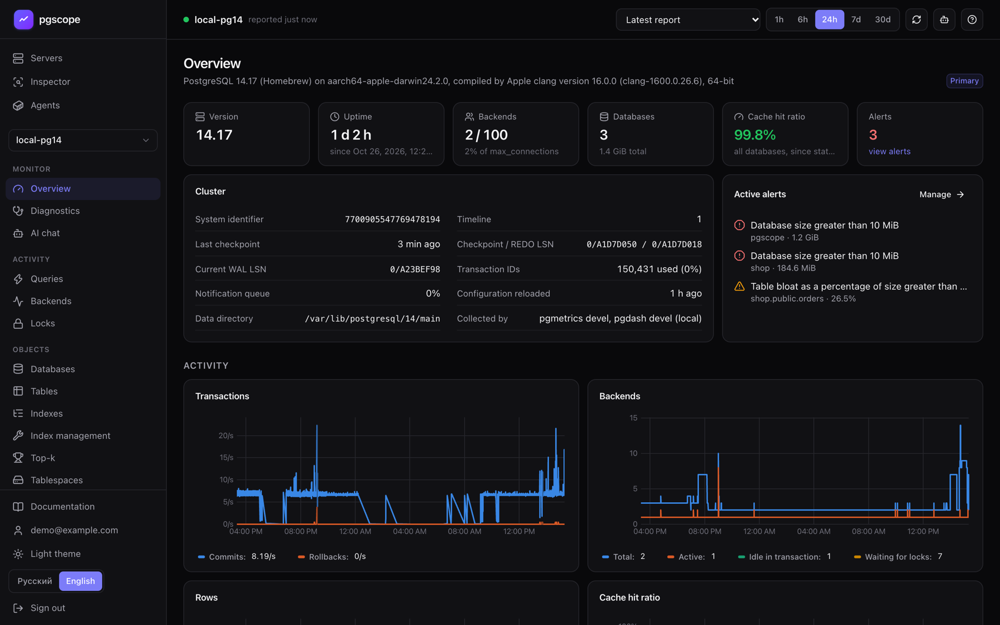
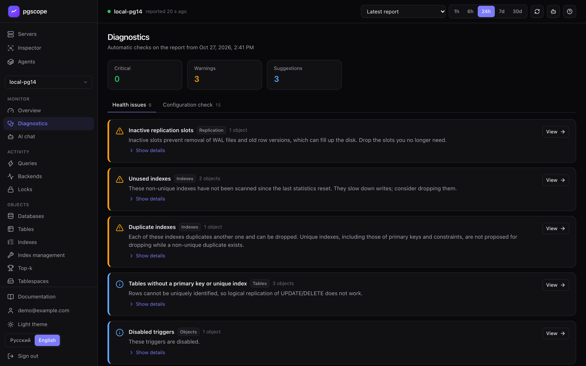
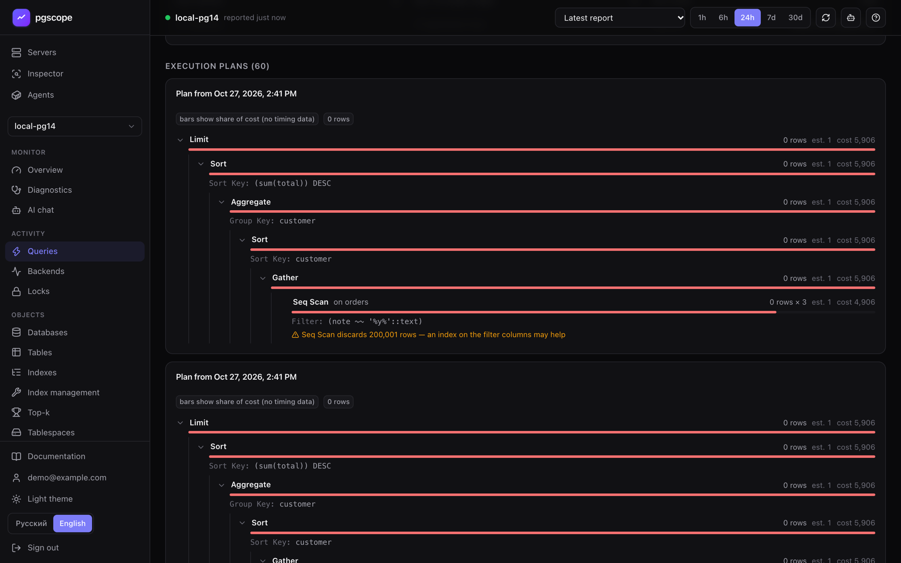
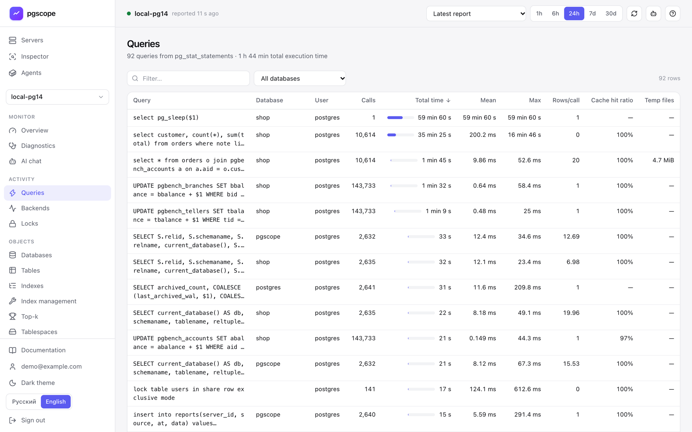
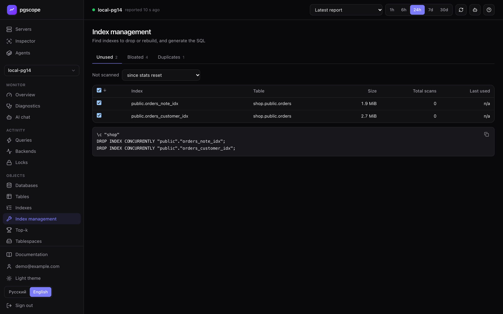
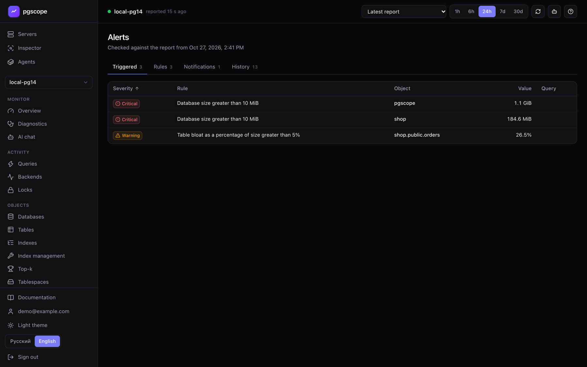
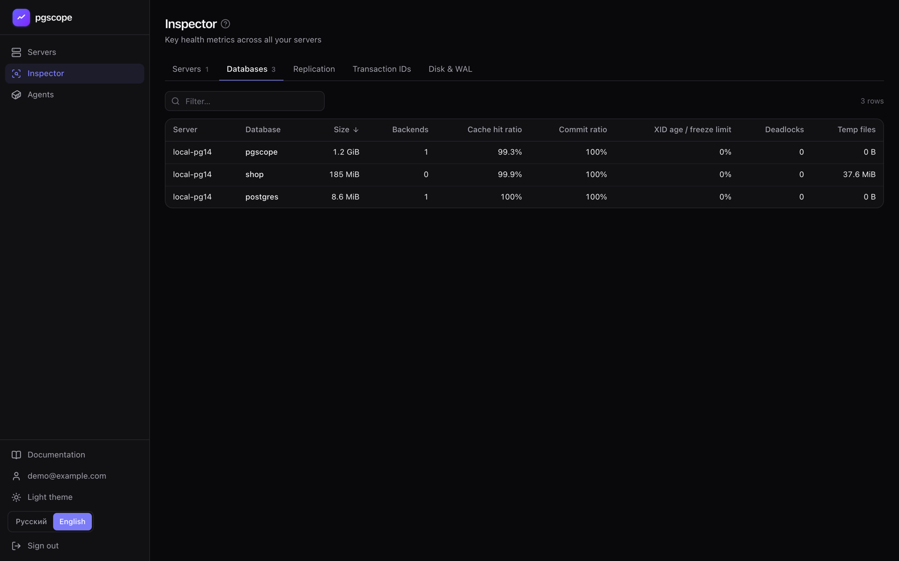
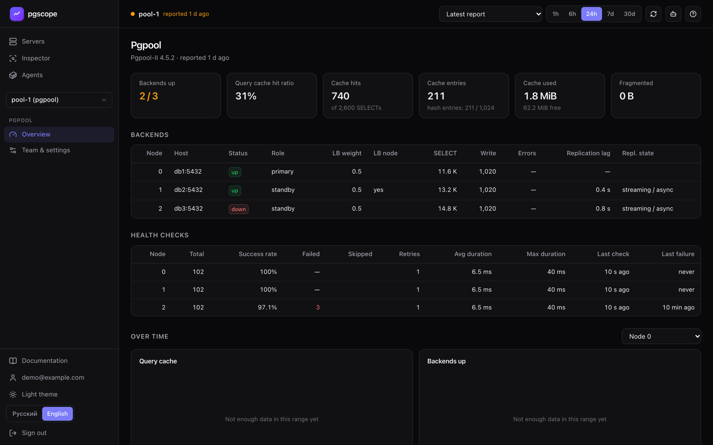
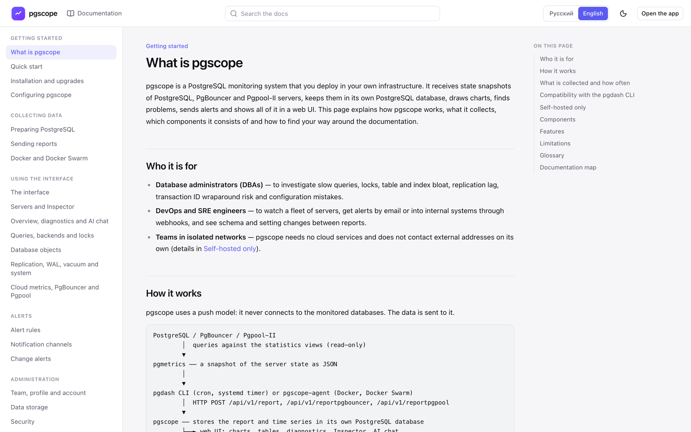
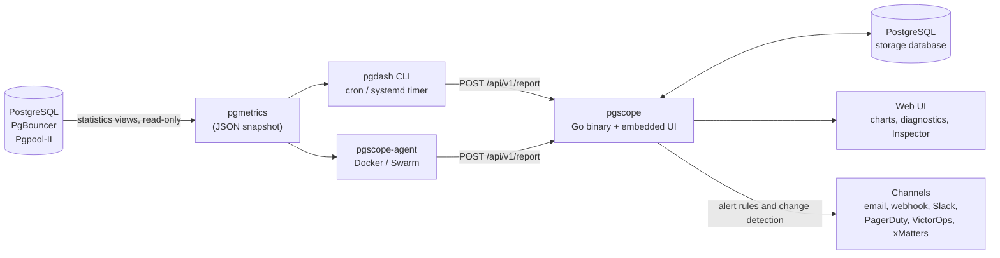

<p align="right"><b>English</b> · <a href="README.ru.md">Русский</a></p>

<h1 align="center">pgscope</h1>

<p align="center">
  Self-hosted PostgreSQL monitoring: a single Go binary with the web UI built in,<br>
  data kept in your own PostgreSQL database, no cloud services, works air-gapped.
</p>

<p align="center">
  
  
  
  
  
  
</p>



pgscope receives state snapshots of PostgreSQL, PgBouncer and Pgpool-II servers, stores them, draws charts,
finds problems, sends alerts and shows it all in a web UI. It uses a push model and never connects to the
monitored databases: the open-source [pgmetrics](https://pgmetrics.io) collects a report, and the
open-source [pgdash CLI](https://github.com/rapidloop/pgdash) or the bundled Docker agent sends it.
pgscope speaks the same ingestion API as the pgdash CLI, so existing cron jobs only need `--base-url`.

## Screenshots

<table>
  <tr>
    <td width="50%"><a href="docs/screenshots/diagnostics.png"></a><br><sub><b>Diagnostics</b>: health issues and a configuration check on every report</sub></td>
    <td width="50%"><a href="docs/screenshots/query-plan.png"></a><br><sub><b>Query page</b>: <code>auto_explain</code> plans as a tree with hints</sub></td>
  </tr>
  <tr>
    <td><a href="docs/screenshots/queries.png"></a><br><sub><b>Queries</b> from <code>pg_stat_statements</code> (light theme)</sub></td>
    <td><a href="docs/screenshots/index-management.png"></a><br><sub><b>Index management</b>: unused, bloated and duplicate indexes with ready SQL</sub></td>
  </tr>
  <tr>
    <td><a href="docs/screenshots/alerts.png"></a><br><sub><b>Alerts</b>: triggered rules, rules, notification channels, history</sub></td>
    <td><a href="docs/screenshots/inspector.png"></a><br><sub><b>Inspector</b>: fleet-wide tables across all servers</sub></td>
  </tr>
  <tr>
    <td><a href="docs/screenshots/pgpool.png"></a><br><sub><b>Pgpool-II</b>: backends, health checks, query cache</sub></td>
    <td><a href="docs/screenshots/docs.png"></a><br><sub><b>Built-in documentation</b>, available without signing in (light theme)</sub></td>
  </tr>
</table>

## Features

**Monitoring**

- **Fleet**: a server list with a short summary, and the **Inspector** with fleet-wide tables of servers, databases, replication, transaction IDs, disk and WAL.
- **Server pages**: overview, queries (`pg_stat_statements` with time series, `auto_explain` plans, suggestions), backends, locks with blocking chains, databases, tables, indexes, index management, top-k (including growth), tablespaces, extensions and other objects, roles, replication and slots, WAL and checkpoints, vacuum, configuration, system metrics, PostgreSQL log.
- **Integrations**: AWS RDS / Aurora and Azure metrics collected by pgmetrics, PgBouncer and Pgpool-II dashboards.
- **Looking into the past**: open any stored report instead of the latest one to see the queries, locks and backends at the time of an incident; charts over 1h to 30d.

**Diagnostics**

- Automatic checks of every report: health issues (critical, warnings, suggestions) and a configuration check. Every check is described in the [checks reference](web/src/docs/en/checks.md).
- Optional AI chat about a server, grounded in its latest report (off by default, see [Security](#security-and-self-hosted-notes)).

**Alerts**

- [Alert rules](web/src/docs/en/alerts.md) on server, database, table, tablespace and query metrics, with **Warning** and **Critical** severities and object filters. Notifications go out when the set of triggered alerts changes.
- [Change alerts](web/src/docs/en/change-alerts.md) between consecutive reports: restarts, version and recovery mode changes, roles, databases, tables, indexes, extensions, settings, replication slots, disabled triggers, sudden size and row count changes.
- [Notification channels](web/src/docs/en/notifications.md): email (SMTP), webhook (JSON), Slack, PagerDuty, VictorOps, xMatters. Each channel has its own language and a test button.

**Teams**

- Share a server by email invitation; an invitation link works without SMTP. Members see all data of the server and edit alert rules and channels, but cannot delete the server or share it further.
- Sign-up policy: by default only the first user can sign up, everyone else joins by invitation (`PGSCOPE_SIGNUP`).

**Docker and Docker Swarm**

- `pgscope-agent` finds PostgreSQL and PgBouncer containers labelled `pgscope.enable=true`, reaches them over Docker networks, runs pgmetrics and sends the reports. It runs per host with Docker Compose or as a global Swarm service; the **Agents** page shows every agent and target.

**Interface**

- Russian and English UI: the language is saved in the profile, server texts (diagnostics, alerts, errors) follow it, and notifications use the language of each channel.
- A per-user time zone in the profile, light and dark themes, and shareable page links.
- [Built-in documentation](#documentation) with search, and **Help** buttons that open the relevant section.

## How it works



1. **pgmetrics** queries the statistics views of a server in a single run and prints a report as JSON.
2. The **pgdash CLI** (on a schedule, usually every 5 minutes) or **pgscope-agent** sends the report to pgscope with your API key.
3. **pgscope** stores the full report compressed, extracts time series from it, evaluates alert rules and compares it with the previous report to detect changes.

Data granularity equals the report interval: this is not real-time monitoring. Full reports are kept for 14 days
(the latest one always), time series and history for 90 days; both are configurable.

## Quick start

You need Docker with Docker Compose, or Go 1.26+ and Node.js 20.19+ / 22.12+ plus any PostgreSQL server for storage.
The full walkthrough is in the [quick start](web/src/docs/en/quickstart.md) and in [installation and upgrades](web/src/docs/en/install.md).

### Option A: Docker Compose

[`deploy/docker-compose.yml`](deploy/docker-compose.yml) runs pgscope together with a `postgres:17-alpine` storage database.

```bash
git clone https://github.com/lomal48/pgscope.git && cd pgscope
docker build -t pgscope:latest .
cd deploy
printf 'PGSCOPE_DB_PASSWORD=%s\nPGSCOPE_BASE_URL=%s\n' 'strong-password' 'http://monitor.example.com:8080' > .env
docker compose up -d
docker compose logs pgscope
```

### Option B: from source

```bash
cd web && npm ci && npm run build && cd .. && go build -o pgscope .

sudo -u postgres createuser --pwprompt pgscope
sudo -u postgres createdb -O pgscope pgscope

PGSCOPE_DB='postgres://pgscope@dbhost:5432/pgscope' \
PGPASSWORD='strong-password' \
PGSCOPE_BASE_URL='http://monitor.example.com:8080' \
./pgscope
```

pgscope creates its tables on start. The web UI is embedded at compile time, so build it before `go build`.

### Sign up and send the first report

1. Open pgscope in a browser and click **Sign up**. With the default `PGSCOPE_SIGNUP=first` only the first user can sign up and becomes the owner, so do it right after the first start.
2. Copy the API key from **Profile**. The **Sending reports** card there has ready-made commands with your key and address.
3. On the monitored server, create a role that can only read statistics:

   ```sql
   CREATE ROLE pgmon LOGIN PASSWORD 'strong-password';
   GRANT pg_monitor TO pgmon;
   ```

4. Send a report (the password comes from `~/.pgpass`), then schedule the same command every 5 minutes:

   ```bash
   pgmetrics --no-password -f json -h dbhost -U pgmon db1 db2 \
     | pgdash -a YOUR_API_KEY --base-url=http://monitor.example.com:8080/api/v1 report prod-db-1
   ```

> [!WARNING]
> Always pass `--base-url`. Without it the pgdash CLI sends the report to the pgDash cloud service instead of your pgscope.

For production, put pgscope behind an HTTPS reverse proxy (it has no TLS of its own) and run it as a systemd
service: see [installation and upgrades](web/src/docs/en/install.md).

## Collecting data

| Method | When to use | Docs |
|---|---|---|
| pgmetrics + pgdash CLI from cron or a systemd timer | databases on hosts or VMs; run on the database host to also get system metrics and the PostgreSQL log (plans, autovacuum history, deadlocks) | [Sending reports](web/src/docs/en/collect.md) |
| pgscope-agent | databases in Docker or Docker Swarm containers | [Docker and Docker Swarm](web/src/docs/en/docker.md) |
| pgmetrics with `--aws-rds-dbid` / Azure flags | AWS RDS, Aurora and Azure, including cloud metrics and logs | [Sending reports](web/src/docs/en/collect.md), [Cloud metrics](web/src/docs/en/integrations.md) |

The **Queries** page needs `pg_stat_statements`, and execution plans need `auto_explain`: see
[preparing PostgreSQL](web/src/docs/en/postgres.md).

### Docker agent

```bash
docker build -f Dockerfile.agent -t pgscope-agent:latest .
cd deploy/agent
mkdir -p secrets
printf '%s' 'API key'                  > secrets/pgscope_api_key
printf '%s' 'pgscope_monitor password' > secrets/pgscope_monitor_password
chmod 600 secrets/*
echo 'PGSCOPE_URL=https://pgscope.example.com' > .env
./bootstrap-monitor-role.sh --with-pg-stat-statements
docker compose up -d
```

Then add the label `pgscope.enable=true` to the database containers. For Swarm use
[`deploy/agent/docker-stack.yml`](deploy/agent/docker-stack.yml). The agent reaches databases over the network,
so logs, plans and system metrics are not collected for its targets.

### pgmetrics built by pgscope

Official pgmetrics releases silently skip the `csvlog` of PostgreSQL 13 and newer, and shift log timestamps when
the server's `log_timezone` differs from the time zone of the pgmetrics host (entries repeat or fall out of the
`--log-span` window). pgscope carries fixes for both in
[`third_party/pgmetrics/`](third_party/pgmetrics/), and
[`tools/build-pgmetrics.sh`](tools/build-pgmetrics.sh) builds pgmetrics at the exact version pgscope uses, with the
fixes applied and their tests run. The agent image is built with the same script.

```bash
tools/build-pgmetrics.sh                                           # ./pgmetrics for this machine
GOOS=linux GOARCH=amd64 tools/build-pgmetrics.sh pgmetrics-amd64   # for an x86-64 database host
```

The script needs Go, `patch` and access to the Go module proxy. Its version ends with `+pgscope` (`pgmetrics -V`).

## Configuration

pgscope is configured with environment variables only, read once at startup.

| Variable | Default | Purpose |
|---|---|---|
| `PGSCOPE_DB` | `postgres://localhost/pgscope` | storage database connection string (URL or `key=value`) |
| `PGSCOPE_LISTEN` | `:8080` | HTTP listen address |
| `PGSCOPE_BASE_URL` | `http://localhost:8080` | public address: links in alerts and invitations, commands in the UI, the cookie `Secure` flag |
| `PGSCOPE_SIGNUP` | `first` | who can sign up: `first` (only the first user), `open` or `closed` |
| `PGSCOPE_MIN_REPORT_INTERVAL` | `60` | minimum seconds between reports of one server (HTTP 429 otherwise); `0` disables |
| `PGSCOPE_MAX_REPORT_MB` | `256` | largest report accepted, compressed and decompressed |
| `PGSCOPE_METRICS_RETENTION_DAYS` | `90` | time series and alert/change history; `0` keeps forever |
| `PGSCOPE_REPORT_RETENTION_DAYS` | `14` | full reports (the latest one is always kept); `0` keeps forever |
| `PGSCOPE_SMTP_ADDR`, `_USER`, `_PASS` | — | SMTP server `host:port` and credentials for email notifications and invitations |
| `PGSCOPE_SMTP_FROM` | `pgscope@localhost` | sender address |
| `PGSCOPE_AI_KEY` | — | Anthropic API key; enables AI chat, which is off without it |
| `PGSCOPE_AI_MODEL` | `claude-opus-5-5` | AI chat model |
| `PGSCOPE_AI_BASE_URL` | — | another Anthropic API address (proxy or gateway) |

Details, validation rules and the Docker Compose variables are in [configuring pgscope](web/src/docs/en/config.md);
the agent variables are in [Docker and Docker Swarm](web/src/docs/en/docker.md).

## Documentation

The documentation, in Russian and English, is built into the app: the **Documentation** link in the sidebar or
`<PGSCOPE_BASE_URL>/#/docs`. It opens without signing in, needs no internet access, has search, and the
**Help** buttons in the UI lead to the relevant section. The sources are Markdown files in [`web/src/docs/`](web/src/docs/) (`en/` and `ru/`).

| Section | Pages |
|---|---|
| Getting started | [What is pgscope](web/src/docs/en/intro.md) · [Quick start](web/src/docs/en/quickstart.md) · [Installation and upgrades](web/src/docs/en/install.md) · [Configuring pgscope](web/src/docs/en/config.md) |
| Collecting data | [Preparing PostgreSQL](web/src/docs/en/postgres.md) · [Sending reports](web/src/docs/en/collect.md) · [Docker and Docker Swarm](web/src/docs/en/docker.md) |
| Using the interface | [The interface](web/src/docs/en/ui.md) · [Servers and Inspector](web/src/docs/en/fleet.md) · [Overview, diagnostics and AI chat](web/src/docs/en/monitoring.md) · [Queries, backends and locks](web/src/docs/en/activity.md) · [Database objects](web/src/docs/en/objects.md) · [Replication, WAL, vacuum and system](web/src/docs/en/server.md) · [Cloud metrics, PgBouncer and Pgpool](web/src/docs/en/integrations.md) |
| Alerts | [Alert rules](web/src/docs/en/alerts.md) · [Notification channels](web/src/docs/en/notifications.md) · [Change alerts](web/src/docs/en/change-alerts.md) |
| Administration | [Team, profile and account](web/src/docs/en/teams.md) · [Data storage](web/src/docs/en/data.md) · [Security](web/src/docs/en/security.md) |
| Reference | [Checks reference](web/src/docs/en/checks.md) · [API](web/src/docs/en/api.md) · [Common scenarios](web/src/docs/en/scenarios.md) · [Troubleshooting and FAQ](web/src/docs/en/troubleshooting.md) |

## Security and self-hosted notes

- No telemetry, no license or update checks. The web UI loads nothing from the internet: scripts and styles are embedded in the binary, and system fonts are used.
- Besides its storage database, pgscope opens outbound connections only for the notification channels you create (your SMTP server, webhook URLs, and the Slack, PagerDuty, VictorOps and xMatters services) and for AI chat.
- **AI chat is optional and calls the Anthropic cloud API**: questions and a summary of the latest report (including query texts) leave your network. It stays off while `PGSCOPE_AI_KEY` is empty; keep it that way in closed networks.
- In an isolated network, use email through an internal SMTP server and webhooks to internal addresses. Images and binaries are built on a machine with internet access and moved in as files (`docker save` / `docker load`), see [installing in an isolated network](web/src/docs/en/install.md).
- pgscope serves plain HTTP: put an HTTPS reverse proxy in front of it. The [security](web/src/docs/en/security.md) page has the threat model and a deployment checklist.

Known limitations: granularity equals the report interval, alert rules are evaluated only when a report arrives,
there is no LDAP or SSO, and one pgscope instance is designed per storage database.

## Development

| Path | Contents |
|---|---|
| `main.go` | entry point: configuration, HTTP server, routes, embedded UI |
| `ingest.go` | report ingestion API (`/api/v1/report`, `/reportpgbouncer`, `/reportpgpool`) |
| `api.go`, `auth.go` | web UI API; accounts, sessions, API keys and team sharing |
| `store.go` | storage schema (created on start), time series, retention |
| `alerts.go`, `diag.go` | alert rules, change alerts and notifications; diagnostics and configuration check |
| `agents.go`, `ai.go` | agent heartbeats (**Agents** page); optional AI chat |
| `i18n.go`, `i18n_en_*.go` | server-side translations: Russian source strings, English dictionaries |
| `cmd/pgscope-agent/` | the Docker / Swarm agent |
| `web/` | UI: React 19, TypeScript, Vite, Tailwind CSS 4, uPlot; `web/src/i18n/en/` dictionaries, `web/src/docs/` documentation |
| `deploy/` | Docker Compose for pgscope; agent compose file, Swarm stack and `bootstrap-monitor-role.sh` |
| `tools/`, `third_party/pgmetrics/` | pgmetrics build script and patches, the backend i18n checker |
| `Dockerfile`, `Dockerfile.agent` | the `pgscope` and `pgscope-agent` images |

Run the backend on the port the Vite dev server proxies `/api` to, and the UI with hot reload:

```bash
(cd web && npm ci && npm run build) && go build -o pgscope .   # go build embeds web/dist
PGSCOPE_LISTEN=127.0.0.1:8091 PGSCOPE_DB=postgres://localhost/pgscope ./pgscope
cd web && npm run dev
```

Checks:

```bash
go vet ./...
go test ./...                       # tests that need a scratch database run with PGSCOPE_TEST_DB set
go run ./tools/i18ncheck            # backend: every Russian string has an English translation
cd web && npx tsc --noEmit && node scripts/i18n-check.mjs   # UI types, dictionaries, docs pages and links
```

User-visible text is written in Russian, which doubles as the key of the English dictionary: `tr`/`trf` with
`i18n_en_*.go` on the backend, `t()` with `web/src/i18n/en/*.json` in the UI. Both checkers fail on a missing
translation.

## License

Copyright 2026 Amirkhan Samigullin. Licensed under the [Apache License, Version 2.0](LICENSE); see also [NOTICE](NOTICE).
The patches in [`third_party/pgmetrics`](third_party/pgmetrics) modify [pgmetrics](https://github.com/rapidloop/pgmetrics), which is also licensed under Apache 2.0.
