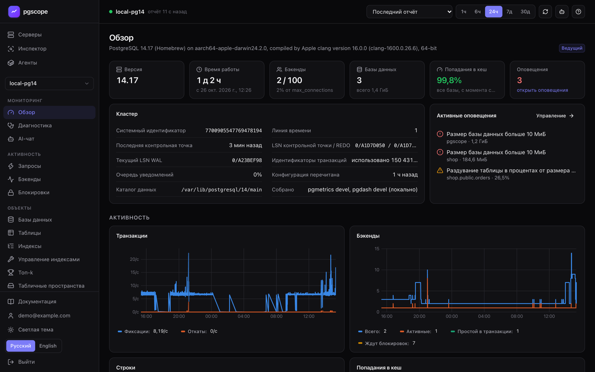
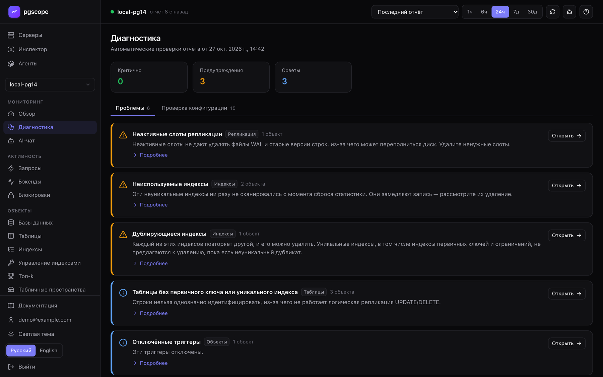
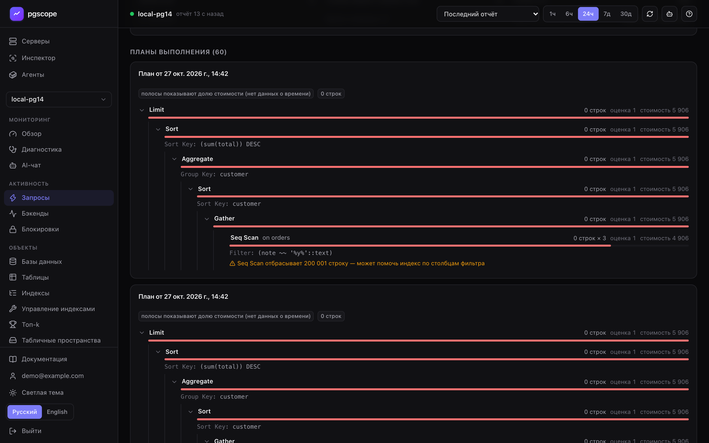
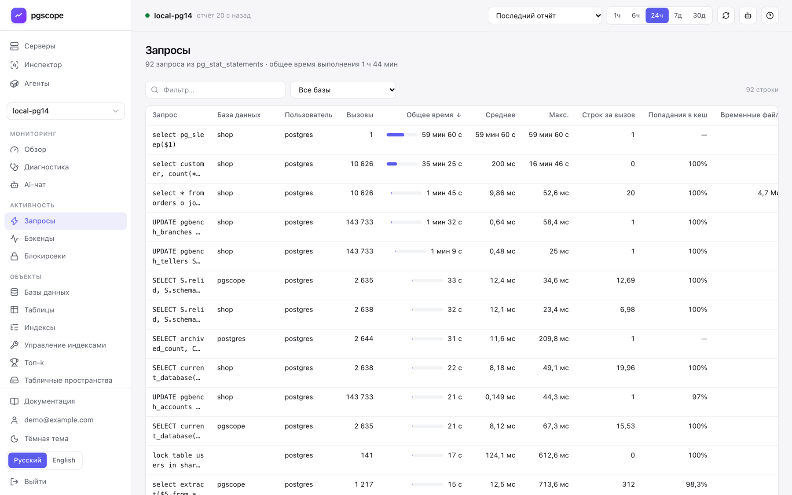
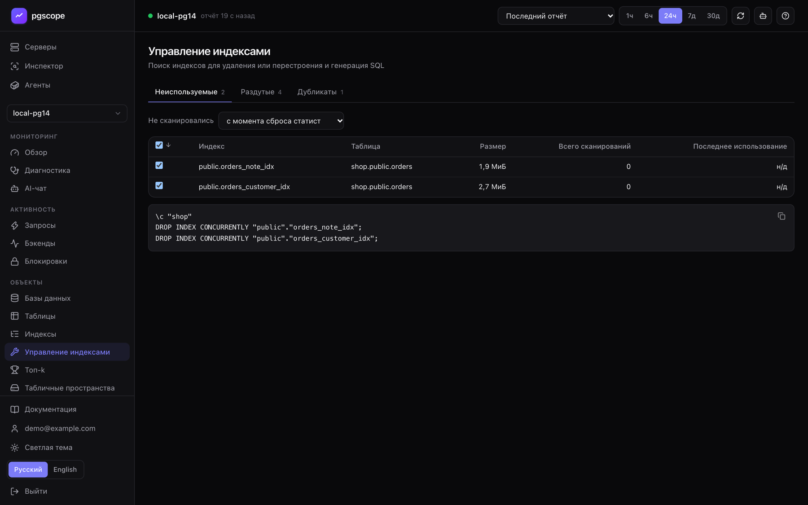
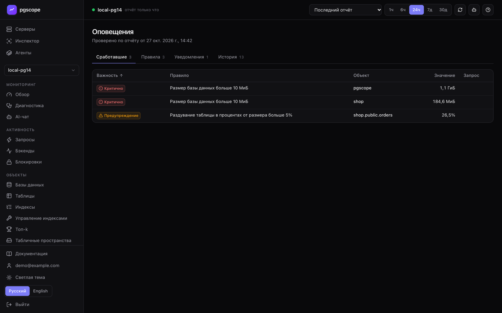
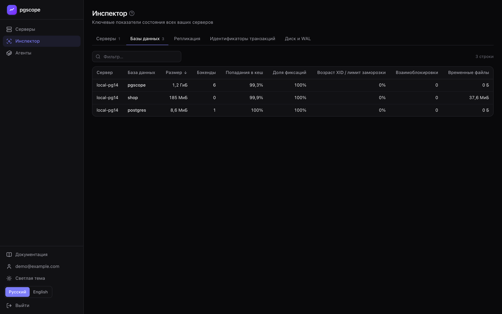
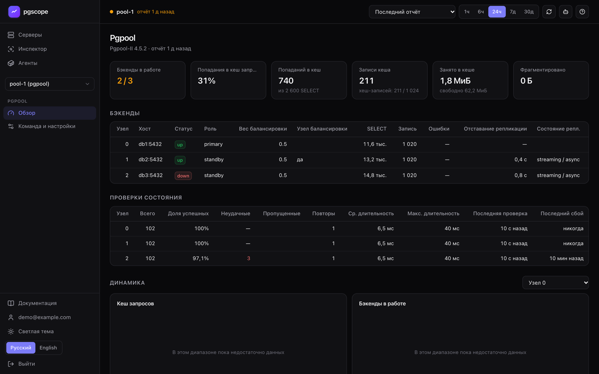
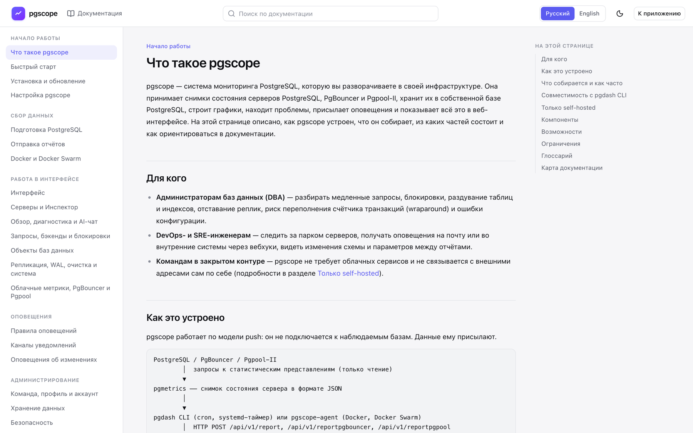
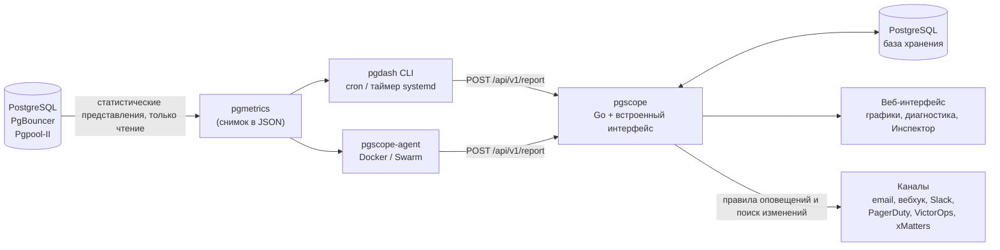

<p align="right"><a href="README.md">English</a> · <b>Русский</b></p>

<h1 align="center">pgscope</h1>

<p align="center">
  Мониторинг PostgreSQL в своей инфраструктуре: один исполняемый файл на Go со встроенным веб-интерфейсом,<br>
  данные в вашей собственной базе PostgreSQL, без облачных сервисов, работает в закрытом контуре.
</p>

<p align="center">
  
  
  
  
  
</p>



pgscope принимает снимки состояния серверов PostgreSQL, PgBouncer и Pgpool-II, хранит их, строит графики,
находит проблемы, присылает оповещения и показывает всё это в веб-интерфейсе. Он работает по модели push и сам
не подключается к наблюдаемым базам: отчёт собирает открытый [pgmetrics](https://pgmetrics.io), а отправляет
открытый [pgdash CLI](https://github.com/rapidloop/pgdash) или агент для Docker из этого репозитория.
pgscope принимает отчёты по тому же API, что и pgdash CLI, поэтому существующим cron-заданиям достаточно `--base-url`.

## Скриншоты

<table>
  <tr>
    <td width="50%"><a href="docs/screenshots/diagnostics.ru.png"></a><br><sub><b>Диагностика</b>: проблемы и проверка конфигурации по каждому отчёту</sub></td>
    <td width="50%"><a href="docs/screenshots/query-plan.ru.png"></a><br><sub><b>Страница запроса</b>: планы <code>auto_explain</code> в виде дерева с подсказками</sub></td>
  </tr>
  <tr>
    <td><a href="docs/screenshots/queries.ru.png"></a><br><sub><b>Запросы</b> из <code>pg_stat_statements</code> (светлая тема)</sub></td>
    <td><a href="docs/screenshots/index-management.ru.png"></a><br><sub><b>Управление индексами</b>: неиспользуемые, раздутые и дублирующиеся индексы с готовым SQL</sub></td>
  </tr>
  <tr>
    <td><a href="docs/screenshots/alerts.ru.png"></a><br><sub><b>Оповещения</b>: сработавшие, правила, каналы уведомлений, история</sub></td>
    <td><a href="docs/screenshots/inspector.ru.png"></a><br><sub><b>Инспектор</b>: сводные таблицы по всем серверам</sub></td>
  </tr>
  <tr>
    <td><a href="docs/screenshots/pgpool.ru.png"></a><br><sub><b>Pgpool-II</b>: бэкенды, проверки состояния, кеш запросов</sub></td>
    <td><a href="docs/screenshots/docs.ru.png"></a><br><sub><b>Встроенная документация</b>, доступна без входа (светлая тема)</sub></td>
  </tr>
</table>

## Возможности

**Мониторинг**

- **Парк серверов**: список серверов с короткой сводкой и **Инспектор** со сводными таблицами серверов, баз данных, репликации, идентификаторов транзакций, диска и WAL.
- **Страницы сервера**: обзор, запросы (`pg_stat_statements` с динамикой, планы `auto_explain`, рекомендации), бэкенды, блокировки с цепочками ожидания, базы данных, таблицы, индексы, управление индексами, топ-k (в том числе по росту), табличные пространства, расширения и другие объекты, роли, репликация и слоты, WAL и контрольные точки, очистка (vacuum), конфигурация, системные метрики, журнал PostgreSQL.
- **Интеграции**: метрики AWS RDS / Aurora и Azure, которые собирает pgmetrics, панели PgBouncer и Pgpool-II.
- **Взгляд в прошлое**: вместо последнего можно открыть любой сохранённый отчёт и увидеть запросы, блокировки и бэкенды на момент инцидента; графики за период от 1 часа до 30 дней.

**Диагностика**

- Автоматические проверки каждого отчёта: проблемы (критичные, предупреждения, советы) и проверка конфигурации. Каждая проверка описана в [справочнике проверок](web/src/docs/ru/checks.md).
- Необязательный AI-чат о сервере по данным его последнего отчёта (по умолчанию выключен, см. [Безопасность](#безопасность-и-работа-в-закрытом-контуре)).

**Оповещения**

- [Правила оповещений](web/src/docs/ru/alerts.md) по метрикам сервера, баз данных, таблиц, табличных пространств и запросов, с уровнями **Предупреждение** и **Критично** и фильтрами объектов. Уведомления отправляются, когда меняется набор сработавших оповещений.
- [Оповещения об изменениях](web/src/docs/ru/change-alerts.md) между соседними отчётами: перезапуски, смена версии и режима восстановления, роли, базы данных, таблицы, индексы, расширения, параметры, слоты репликации, отключённые триггеры, резкие изменения размеров и числа строк.
- [Каналы уведомлений](web/src/docs/ru/notifications.md): email (SMTP), вебхук (JSON), Slack, PagerDuty, VictorOps, xMatters. У каждого канала свой язык и кнопка проверки.

**Команда**

- Доступ к серверу открывается приглашением по email; ссылка-приглашение работает и без SMTP. Участники видят все данные сервера и меняют правила оповещений и каналы, но не могут удалить сервер или поделиться им дальше.
- Регистрация: по умолчанию зарегистрироваться может только первый пользователь, остальные приходят по приглашениям (`PGSCOPE_SIGNUP`).

**Docker и Docker Swarm**

- `pgscope-agent` находит контейнеры PostgreSQL и PgBouncer с меткой `pgscope.enable=true`, подключается к ним по сетям Docker, запускает pgmetrics и отправляет отчёты. Он работает на каждом хосте через Docker Compose или как глобальный сервис Swarm; страница «Агенты» показывает все агенты и их цели.

**Интерфейс**

- Русский и английский интерфейс: язык сохраняется в профиле, тексты сервера (диагностика, оповещения, ошибки) следуют ему, а уведомления приходят на языке, заданном для каждого канала.
- Часовой пояс пользователя в профиле, светлая и тёмная темы, ссылки на страницы, которыми можно поделиться.
- [Встроенная документация](#документация) с поиском и кнопки «Справка», которые открывают нужный раздел.

## Как это устроено



1. **pgmetrics** за один запуск опрашивает статистические представления сервера и выводит отчёт в JSON.
2. **pgdash CLI** (по расписанию, обычно раз в 5 минут) или **pgscope-agent** отправляет отчёт в pgscope с вашим API-ключом.
3. **pgscope** сохраняет полный отчёт в сжатом виде, извлекает из него временные ряды, проверяет правила оповещений и сравнивает отчёт с предыдущим, чтобы найти изменения.

Детализация данных равна интервалу отчётов: это не мониторинг в реальном времени. Полные отчёты хранятся 14 дней
(последний — всегда), временные ряды и история — 90 дней; оба срока настраиваются.

## Быстрый старт

Нужны Docker с Docker Compose или Go 1.26+ и Node.js 20.19+ / 22.12+ плюс любой сервер PostgreSQL для хранения данных.
Подробно — в [быстром старте](web/src/docs/ru/quickstart.md) и в разделе [установка и обновление](web/src/docs/ru/install.md).

### Вариант A: Docker Compose

[`deploy/docker-compose.yml`](deploy/docker-compose.yml) запускает pgscope вместе с базой хранения `postgres:17-alpine`.

```bash
git clone https://github.com/lomal48/pgscope.git && cd pgscope
docker build -t pgscope:latest .
cd deploy
printf 'PGSCOPE_DB_PASSWORD=%s\nPGSCOPE_BASE_URL=%s\n' 'strong-password' 'http://monitor.example.com:8080' > .env
docker compose up -d
docker compose logs pgscope
```

### Вариант B: из исходников

```bash
cd web && npm ci && npm run build && cd .. && go build -o pgscope .

sudo -u postgres createuser --pwprompt pgscope
sudo -u postgres createdb -O pgscope pgscope

PGSCOPE_DB='postgres://pgscope@dbhost:5432/pgscope' \
PGPASSWORD='strong-password' \
PGSCOPE_BASE_URL='http://monitor.example.com:8080' \
./pgscope
```

pgscope создаёт свои таблицы при запуске. Веб-интерфейс встраивается при компиляции, поэтому соберите его до `go build`.

### Регистрация и первый отчёт

1. Откройте pgscope в браузере и нажмите «Регистрация». При значении по умолчанию `PGSCOPE_SIGNUP=first` зарегистрироваться может только первый пользователь, и он становится владельцем, поэтому сделайте это сразу после первого запуска.
2. Скопируйте API-ключ в «Профиле». Там же, в карточке «Отправка отчётов», есть готовые команды с вашим ключом и адресом.
3. На наблюдаемом сервере создайте роль, которая может только читать статистику:

   ```sql
   CREATE ROLE pgmon LOGIN PASSWORD 'strong-password';
   GRANT pg_monitor TO pgmon;
   ```

4. Отправьте отчёт (пароль берётся из `~/.pgpass`), затем поставьте ту же команду в расписание раз в 5 минут:

   ```bash
   pgmetrics --no-password -f json -h dbhost -U pgmon db1 db2 \
     | pgdash -a YOUR_API_KEY --base-url=http://monitor.example.com:8080/api/v1 report prod-db-1
   ```

> [!WARNING]
> Всегда указывайте `--base-url`. Без него pgdash CLI отправит отчёт в облачный сервис pgDash, а не в ваш pgscope.

Для постоянной работы поставьте перед pgscope обратный прокси с HTTPS (собственного TLS в нём нет) и запустите его
как службу systemd: см. [установка и обновление](web/src/docs/ru/install.md).

## Сбор данных

| Способ | Когда подходит | Документация |
|---|---|---|
| pgmetrics + pgdash CLI из cron или таймера systemd | базы на хостах и виртуальных машинах; запуск на хосте базы даёт ещё системные метрики и журнал PostgreSQL (планы, история автоочистки, взаимоблокировки) | [Отправка отчётов](web/src/docs/ru/collect.md) |
| pgscope-agent | базы в контейнерах Docker или Docker Swarm | [Docker и Docker Swarm](web/src/docs/ru/docker.md) |
| pgmetrics с `--aws-rds-dbid` / флагами Azure | AWS RDS, Aurora и Azure, включая облачные метрики и журналы | [Отправка отчётов](web/src/docs/ru/collect.md), [Облачные метрики](web/src/docs/ru/integrations.md) |

Странице «Запросы» нужен `pg_stat_statements`, планам выполнения — `auto_explain`: см.
[подготовка PostgreSQL](web/src/docs/ru/postgres.md).

### Агент для Docker

```bash
docker build -f Dockerfile.agent -t pgscope-agent:latest .
cd deploy/agent
mkdir -p secrets
printf '%s' 'API key'                  > secrets/pgscope_api_key
printf '%s' 'pgscope_monitor password' > secrets/pgscope_monitor_password
chmod 600 secrets/*
echo 'PGSCOPE_URL=https://pgscope.example.com' > .env
./bootstrap-monitor-role.sh --with-pg-stat-statements
docker compose up -d
```

Затем добавьте контейнерам с базами метку `pgscope.enable=true`. Для Swarm используйте
[`deploy/agent/docker-stack.yml`](deploy/agent/docker-stack.yml). Агент подключается к базам по сети, поэтому
журналы, планы и системные метрики для его целей не собираются.

### pgmetrics в сборке pgscope

Официальные выпуски pgmetrics молча пропускают `csvlog` PostgreSQL 13 и новее и сдвигают время записей журнала,
когда `log_timezone` сервера отличается от часового пояса хоста pgmetrics (записи повторяются или выпадают из окна
`--log-span`). Исправления обеих проблем лежат в [`third_party/pgmetrics/`](third_party/pgmetrics/), а
[`tools/build-pgmetrics.sh`](tools/build-pgmetrics.sh) собирает pgmetrics ровно той версии, с которой собран pgscope,
применяет исправления и прогоняет их тесты. Образ агента собирается тем же скриптом.

```bash
tools/build-pgmetrics.sh                                           # ./pgmetrics для этой машины
GOOS=linux GOARCH=amd64 tools/build-pgmetrics.sh pgmetrics-amd64   # для хоста базы на x86-64
```

Скрипту нужны Go, `patch` и доступ к прокси модулей Go. Версия такой сборки заканчивается на `+pgscope` (`pgmetrics -V`).

## Настройка

pgscope настраивается только переменными окружения, они читаются один раз при запуске.

| Переменная | По умолчанию | Назначение |
|---|---|---|
| `PGSCOPE_DB` | `postgres://localhost/pgscope` | строка подключения к базе хранения (URL или `key=value`) |
| `PGSCOPE_LISTEN` | `:8080` | адрес HTTP-сервера |
| `PGSCOPE_BASE_URL` | `http://localhost:8080` | публичный адрес: ссылки в оповещениях и приглашениях, команды в интерфейсе, флаг `Secure` у cookie |
| `PGSCOPE_SIGNUP` | `first` | кто может зарегистрироваться: `first` (только первый пользователь), `open` или `closed` |
| `PGSCOPE_MIN_REPORT_INTERVAL` | `60` | минимум секунд между отчётами одного сервера (иначе HTTP 429); `0` отключает |
| `PGSCOPE_MAX_REPORT_MB` | `256` | наибольший принимаемый отчёт, в сжатом и распакованном виде |
| `PGSCOPE_METRICS_RETENTION_DAYS` | `90` | временные ряды и история оповещений и изменений; `0` — хранить всегда |
| `PGSCOPE_REPORT_RETENTION_DAYS` | `14` | полные отчёты (последний хранится всегда); `0` — хранить всегда |
| `PGSCOPE_SMTP_ADDR`, `_USER`, `_PASS` | — | SMTP-сервер `host:port` и учётные данные для писем с уведомлениями и приглашениями |
| `PGSCOPE_SMTP_FROM` | `pgscope@localhost` | адрес отправителя |
| `PGSCOPE_AI_KEY` | — | ключ Anthropic API; включает AI-чат, без него чат выключен |
| `PGSCOPE_AI_MODEL` | `claude-opus-5-5` | модель AI-чата |
| `PGSCOPE_AI_BASE_URL` | — | другой адрес Anthropic API (прокси или шлюз) |

Подробности, правила проверки значений и переменные Docker Compose — в разделе [настройка pgscope](web/src/docs/ru/config.md);
переменные агента — в разделе [Docker и Docker Swarm](web/src/docs/ru/docker.md).

## Документация

Документация на русском и английском встроена в приложение: ссылка «Документация» в боковом меню или
`<PGSCOPE_BASE_URL>/#/docs`. Она открывается без входа, не требует интернета, в ней есть поиск, а кнопки «Справка»
в интерфейсе ведут в нужный раздел. Исходники — Markdown-файлы в [`web/src/docs/`](web/src/docs/) (`ru/` и `en/`).

| Раздел | Страницы |
|---|---|
| Начало работы | [Что такое pgscope](web/src/docs/ru/intro.md) · [Быстрый старт](web/src/docs/ru/quickstart.md) · [Установка и обновление](web/src/docs/ru/install.md) · [Настройка pgscope](web/src/docs/ru/config.md) |
| Сбор данных | [Подготовка PostgreSQL](web/src/docs/ru/postgres.md) · [Отправка отчётов](web/src/docs/ru/collect.md) · [Docker и Docker Swarm](web/src/docs/ru/docker.md) |
| Работа в интерфейсе | [Интерфейс](web/src/docs/ru/ui.md) · [Серверы и Инспектор](web/src/docs/ru/fleet.md) · [Обзор, диагностика и AI-чат](web/src/docs/ru/monitoring.md) · [Запросы, бэкенды и блокировки](web/src/docs/ru/activity.md) · [Объекты баз данных](web/src/docs/ru/objects.md) · [Репликация, WAL, очистка и система](web/src/docs/ru/server.md) · [Облачные метрики, PgBouncer и Pgpool](web/src/docs/ru/integrations.md) |
| Оповещения | [Правила оповещений](web/src/docs/ru/alerts.md) · [Каналы уведомлений](web/src/docs/ru/notifications.md) · [Оповещения об изменениях](web/src/docs/ru/change-alerts.md) |
| Администрирование | [Команда, профиль и аккаунт](web/src/docs/ru/teams.md) · [Хранение данных](web/src/docs/ru/data.md) · [Безопасность](web/src/docs/ru/security.md) |
| Справочник | [Справочник проверок](web/src/docs/ru/checks.md) · [API](web/src/docs/ru/api.md) · [Типовые сценарии](web/src/docs/ru/scenarios.md) · [Решение проблем и FAQ](web/src/docs/ru/troubleshooting.md) |

## Безопасность и работа в закрытом контуре

- Никакой телеметрии, проверок лицензий и обновлений. Веб-интерфейс ничего не загружает из интернета: скрипты и стили встроены в исполняемый файл, используются системные шрифты.
- Кроме подключения к базе хранения, pgscope открывает исходящие соединения только для созданных вами каналов уведомлений (ваш SMTP-сервер, адреса вебхуков, сервисы Slack, PagerDuty, VictorOps и xMatters) и для AI-чата.
- **AI-чат необязателен и обращается к облачному Anthropic API**: вопросы и выжимка последнего отчёта (включая тексты запросов) уходят за пределы вашей сети. Пока `PGSCOPE_AI_KEY` пуст, чат выключен; в закрытом контуре так его и оставьте.
- В изолированной сети используйте почту через внутренний SMTP-сервер и вебхуки на внутренние адреса. Образы и исполняемые файлы собираются на машине с интернетом и переносятся в контур файлами (`docker save` / `docker load`), см. [установка в закрытом контуре](web/src/docs/ru/install.md).
- pgscope отдаёт только HTTP: ставьте перед ним обратный прокси с HTTPS. В разделе [безопасность](web/src/docs/ru/security.md) — модель угроз и чек-лист развёртывания.

Известные ограничения: детализация равна интервалу отчётов, правила оповещений проверяются только при поступлении
отчёта, входа через LDAP или SSO нет, на одну базу хранения рассчитан один экземпляр pgscope.

## Разработка

| Путь | Содержимое |
|---|---|
| `main.go` | точка входа: настройки, HTTP-сервер, маршруты, встроенный интерфейс |
| `ingest.go` | API приёма отчётов (`/api/v1/report`, `/reportpgbouncer`, `/reportpgpool`) |
| `api.go`, `auth.go` | API веб-интерфейса; аккаунты, сессии, API-ключи и совместный доступ |
| `store.go` | схема базы хранения (создаётся при запуске), временные ряды, сроки хранения |
| `alerts.go`, `diag.go` | правила оповещений, оповещения об изменениях и уведомления; диагностика и проверка конфигурации |
| `agents.go`, `ai.go` | сигналы агентов (страница «Агенты»); необязательный AI-чат |
| `i18n.go`, `i18n_en_*.go` | переводы на сервере: русские исходные строки, английские словари |
| `cmd/pgscope-agent/` | агент для Docker / Swarm |
| `web/` | интерфейс: React 19, TypeScript, Vite, Tailwind CSS 4, uPlot; словари `web/src/i18n/en/`, документация `web/src/docs/` |
| `deploy/` | Docker Compose для pgscope; compose-файл агента, стек для Swarm и `bootstrap-monitor-role.sh` |
| `tools/`, `third_party/pgmetrics/` | скрипт сборки pgmetrics и исправления к нему, проверка переводов сервера |
| `Dockerfile`, `Dockerfile.agent` | образы `pgscope` и `pgscope-agent` |

Сервер запускается на порту, на который dev-сервер Vite проксирует `/api`, а интерфейс — с горячей перезагрузкой:

```bash
(cd web && npm ci && npm run build) && go build -o pgscope .   # go build встраивает web/dist
PGSCOPE_LISTEN=127.0.0.1:8091 PGSCOPE_DB=postgres://localhost/pgscope ./pgscope
cd web && npm run dev
```

Проверки:

```bash
go vet ./...
go test ./...                       # тесты, которым нужна тестовая база, запускаются с PGSCOPE_TEST_DB
go run ./tools/i18ncheck            # сервер: у каждой русской строки есть английский перевод
cd web && npx tsc --noEmit && node scripts/i18n-check.mjs   # типы интерфейса, словари, страницы и ссылки документации
```

Видимые пользователю тексты пишутся по-русски, и русская строка служит ключом английского словаря: `tr`/`trf` и
`i18n_en_*.go` на сервере, `t()` и `web/src/i18n/en/*.json` в интерфейсе. Обе проверки падают, если перевода нет.
